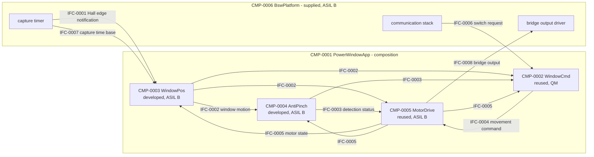
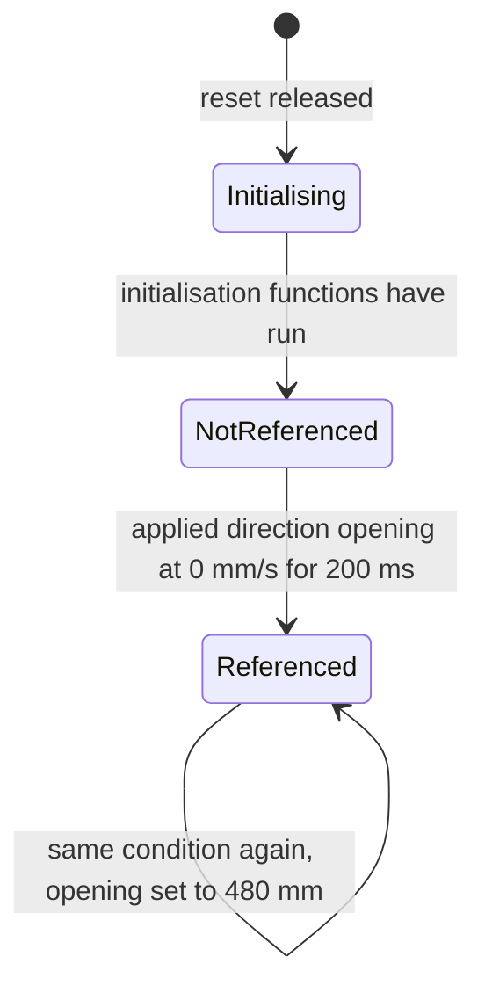
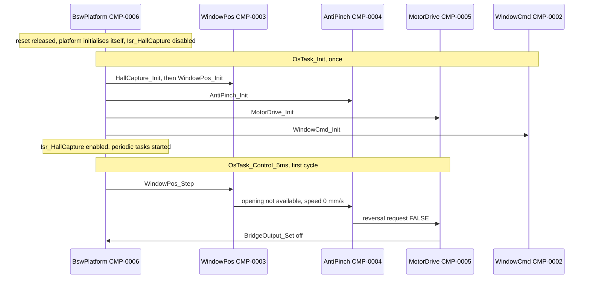

# Architecture view items

File: `spec/views/<ID>.md`. Attributes and sections are those of type
`architecture-view` in `schema/items.yaml`. A view of the software architecture has
`level: software`. A view describes several elements together; what concerns one
component alone stays in that component's `Dynamic behavior` section.

Every project needs, at software level, one view of each of the kinds `structure`,
`execution-model` and `resource-summary`, and at least one of the kinds `state-machine`
or `sequence` (`COV-25`). One worked example per kind follows. Three are views of
`examples/power-window` in shortened form (the full text is in its `spec/views/`); two
are further views of the same architecture, written the way this skill would draft them.

## What is needed when

| Attribute or section | Needed | What to write |
|---|---|---|
| `id`, `type`, `title`, `status` | always | `title`: what the view shows |
| `level`, `kind` | always | `software`; one of the kinds below |
| `Description` | before review | what the view shows, how to read it, what follows from it |
| `Diagram` | before review for `context`, `structure`, `state-machine`, `sequence` | one Mermaid or PlantUML code block |
| `table` | before review for `execution-model`, `memory-layout`, `resource-summary`, `fault-reaction` | rows of the structure that belongs to the kind |
| `links.shows` | every view (`COV-24`) | every component and interface that appears in the view |

Rules for every view:

- Every element with an ID in the diagram or table is an item, is named in `shows`, and
  carries the name its item has. Everything named in `shows` appears in the view.
- `Description` and diagram say the same thing. The description tells the reader what
  to look for; it does not retell the picture line by line.
- A view is suspect as soon as an item it shows changes. Keep a view to one subject, so
  that a change touches few views.
- Keep diagram labels plain: no colon or semicolon inside a label, and "percent" written
  out, as the example views do.

## Structure

Must show: every component of the level described, inside its composition, with ID,
name, origin and ASIL; every interface between them as a labelled connection with its
ID; supplied and basic software next to the developed components. The description
states what an arrow means. A box without an ID is allowed only inside a supplied
component, to show where an interface ends. A large architecture gets one overview of
the compositions and one structure view per composition, each an item of its own.

````markdown
---
id: VIEW-0001
type: architecture-view
title: Static structure of the power window software
status: draft
level: software
kind: structure
links:
  shows: [CMP-0001, CMP-0002, CMP-0003, CMP-0004, CMP-0005, CMP-0006, IFC-0001, IFC-0002, IFC-0003, IFC-0004, IFC-0005, IFC-0006, IFC-0007, IFC-0008]
---

## Description

The delivered composition PowerWindowApp with its four components, the basic software
of the customer next to it, and every interface between them. An arrow points from the
provider of data to its user; for the two function-call interfaces towards the basic
software it points from caller to callee.

Two things to read from the picture:

- The path from the Hall sensor to the bridge - WindowPos, AntiPinch, MotorDrive - is
  ASIL B throughout and takes no input from WindowCmd.
- WindowCmd (QM) only consumes data and issues the movement command; MotorDrive lets
  the reversal request of AntiPinch override that command.

## Diagram


````

## State machine

Must show: the states under the names used in requirements and code; the initial
state; every transition with its trigger or condition in words; per state what each
component involved does or delivers, as a table; the exits taken on a failure and the
way back; times where a requirement sets one; which component owns the state.
Typical subjects: operating modes of the ECU (start-up, normal operation, degraded
operation, shut-down and sleep, diagnosis or reprogramming where they exist) and the
states of a function that spans components (VIEW-0002 of the example).

````markdown
---
id: VIEW-0006
type: architecture-view
title: Operating modes of the application after reset
status: draft
level: software
kind: state-machine
links:
  shows: [CMP-0002, CMP-0003, CMP-0004, CMP-0005, CMP-0006, IFC-0002, IFC-0005]
---

## Description

What the delivered software can do depends on whether the window opening is known. The
opening is not stored over a reset (SYE-0001), so every reset starts in Initialising
and passes through NotReferenced. The mode is not a variable of its own: it is the
availability of the position on IFC-0002, which WindowPos owns and every other
component reads there.

| Mode | Position on IFC-0002 | WindowCmd | AntiPinch |
|---|---|---|---|
| Initialising | not read by anyone | not running | not running |
| NotReferenced | not available | manual movement only, automatic closing refused (SWR-0008) | supervises closing over the whole travel (SWR-0004) |
| Referenced | 0 mm to 480 mm | all movements | supervises closing above an opening of 5 mm (SWR-0004) |

MotorDrive behaves the same in NotReferenced and Referenced. Initialising ends when the
platform (CMP-0006) has run the initialisation functions; the software has to be ready
50 ms after the reset is released (SYE-0001). "Applied direction" is the element of
IFC-0005; the condition of the transition to Referenced is the one of SWR-0002. There
is no way from Referenced back to NotReferenced other than a reset, which is possible
in every mode and leads to Initialising.

## Diagram


````

## Sequence

Must show: one scenario with its starting condition, not "the general case"; the
components as participants, with their IDs; messages that are operations or data
elements of interface items; the task cycle or interrupt in which each part runs; the
time spent along the chain against the requirement that limits it, as a table; the
path taken when a step fails or times out, or the reason why there is none.
Typical subjects: start-up, shut-down and wake-up, each chain from an input to an
output that has a timing requirement (VIEW-0003 of the example: the obstacle reversal),
and the handling of a fault from detection to reaction.

````markdown
---
id: VIEW-0007
type: architecture-view
title: Sequence of the start-up until the first control cycle
status: draft
level: software
kind: sequence
links:
  shows: [CMP-0002, CMP-0003, CMP-0004, CMP-0005, CMP-0006, IFC-0001, IFC-0002, IFC-0003, IFC-0008]
---

## Description

From the release of the reset to the first cycle of the control task. The order is
fixed by the execution model (VIEW-0004): the platform runs the initialisation
functions once in `OsTask_Init` while the capture interrupt is still disabled, and only
then lets Hall edges (IFC-0001) and the periodic tasks in.

| Step | Time | Source |
|---|---|---|
| Platform initialised, `OsTask_Init` activated | set by the customer | CMP-0006 |
| Application initialised | within the 100 us budget of `OsTask_Init` | VIEW-0004 |
| Software ready, motor stopped | 50 ms after the reset is released | SYE-0001 |

The application uses 100 us of the 50 ms; the rest is the start-up of the platform,
which the customer budgets. After the initialisation the window opening is not
available, the speed is 0 mm/s, no reversal is requested and the bridge is off (mode
NotReferenced of VIEW-0006). The sequence has no failure branch: the application
restores nothing from memory (SYE-0001) and runs no self-test, so none of its steps
can fail.

## Diagram


````

## Execution model

`table` holds one row of the structure `tasks` per task, per interrupt and for the
initialisation. Mandatory keys: `name`, `activation` (`periodic`, `event` or
`interrupt`), `priority`, `entries` (the entry functions in calling order). Further
keys: `period_ms`, `budget_us`, `stack_bytes`, `preemptable`, `core`.

Must show, in the table: every entry function of every component in exactly one row;
a period for every periodic row; a budget and a stack size for every row. In the
description: who configures the operating system; what a higher priority number means;
what activates each row and how often at most; why the entries are in this order; what
can preempt what; which data is shared between rows and how it is protected; the delay
other rows can cause and why the timing requirements still hold; how each budget is
formed and the processor load that results.

````markdown
---
id: VIEW-0004
type: architecture-view
title: Execution model
status: draft
level: software
kind: execution-model
table:
  - {name: OsTask_Init, activation: event, priority: 30, entries: [HallCapture_Init, WindowPos_Init, AntiPinch_Init, MotorDrive_Init, WindowCmd_Init], budget_us: 100, stack_bytes: 256, preemptable: false, core: 0}
  - {name: Isr_HallCapture, activation: interrupt, priority: 40, entries: [HallCapture_OnEdge], budget_us: 10, stack_bytes: 64, preemptable: false, core: 0}
  - {name: OsTask_Control_5ms, activation: periodic, period_ms: 5, priority: 20, entries: [WindowPos_Step, AntiPinch_Step, MotorDrive_Step], budget_us: 150, stack_bytes: 256, preemptable: false, core: 0}
  - {name: OsTask_Command_20ms, activation: periodic, period_ms: 20, priority: 10, entries: [WindowCmd_Step], budget_us: 140, stack_bytes: 256, preemptable: false, core: 0}
links:
  shows: [CMP-0002, CMP-0003, CMP-0004, CMP-0005, CMP-0006, IFC-0001, IFC-0007]
---

## Description

The tasks and the interrupt in which the delivered functions run. The operating system
and its configuration belong to the basic software of the customer (CMP-0006); the
table states what the application needs from it. A higher priority number means a
higher priority. `entries` lists the functions in calling order.

- **OsTask_Init** runs once at start-up with `Isr_HallCapture` still disabled.
- **Isr_HallCapture** is the capture interrupt of the Hall sensor input (IFC-0001), at
  most 400 times per second. It is locked only inside exclusive area HallData.
- **OsTask_Control_5ms** carries the path from sensor to bridge. Position and speed
  first, then the detection, then the motor command, so that a detection reaches the
  bridge in the same cycle. The integration code reads the capture time (IFC-0007) once
  at the start of the task and passes interface values between the entries.
- **OsTask_Command_20ms** runs the comfort logic.

Tasks do not preempt each other; only the interrupt interrupts a task. Data shared
between tasks therefore needs no protection, data shared with the interrupt is
protected by the exclusive area. The 5 ms task can be delayed by the longest other
task (140 us) and by one interrupt (10 us); this is inside the 5 ms left over in the
budget of the obstacle reaction (SWR-0004, Analysis).

Each `budget_us` is the sum of the execution time objectives of the components plus
20 us for the integration code of a periodic task. Processor load at these budgets:
150 us / 5 ms + 140 us / 20 ms + 400 x 10 us / 1 s = 3.0 % + 0.7 % + 0.4 % = 4.1 %.
````

## Resource summary

`table` holds one row of the structure `resource-totals` per limited resource.
Mandatory keys: `resource` (name with unit), `capacity`, `objective`. Further keys:
`reserve_percent`, `measured`.

Must show: a row for program memory, for static RAM, for every stack, for processor
load and for non-volatile data memory where the software uses it; where each capacity
comes from; how each objective is formed from the component budgets, with the sum
written out; the reserve that has to stay free; what is not part of the summary and
who budgets that. For every row the objective is at most capacity x (100 -
reserve_percent) / 100. `measured` stays absent until a value exists, and the
description says who measures, how and when.

````markdown
---
id: VIEW-0005
type: architecture-view
title: Resource summary of the application
status: draft
level: software
kind: resource-summary
table:
  - {resource: "program flash of the application (bytes)", capacity: 16384, objective: 9216, reserve_percent: 20}
  - {resource: "static RAM of the application (bytes)", capacity: 1024, objective: 192, reserve_percent: 20}
  - {resource: "stack of OsTask_Control_5ms (bytes)", capacity: 256, objective: 128, reserve_percent: 30}
  - {resource: "stack of OsTask_Command_20ms (bytes)", capacity: 256, objective: 160, reserve_percent: 30}
  - {resource: "interrupt stack share of Isr_HallCapture (bytes)", capacity: 64, objective: 32, reserve_percent: 30}
  - {resource: "processor load of the application (percent)", capacity: 10, objective: 4.1, reserve_percent: 20}
links:
  shows: [CMP-0001, CMP-0002, CMP-0003, CMP-0004, CMP-0005]
---

## Description

Totals of the resource objectives of the delivered composition against what the
customer has assigned to it (SYE-0001). `capacity` is the assigned share, `objective`
the sum of the component budgets, `reserve_percent` the share of the capacity that has
to stay free at delivery. Every objective is below capacity minus reserve.

| Resource | How the objective is formed |
|---|---|
| Program flash | 3072 + 2048 + 1536 + 2560 bytes (CMP-0002 to CMP-0005) |
| Static RAM | 96 + 32 + 16 + 48 bytes |
| Stack, 5 ms task | largest of 96, 64 and 96 bytes (the entries run one after the other) plus 32 bytes for the calling integration function |
| Stack, 20 ms task | 128 bytes plus 32 bytes |
| Interrupt stack | 32 bytes for `HallCapture_OnEdge` |
| Processor load | task and interrupt budgets of VIEW-0004: 3.0 % + 0.7 % + 0.4 % |

The basic software (CMP-0006) is not part of this summary; its resources are the
customer's. No measured values are entered yet: the sizes come from the map file and
the run times from measurements on the door module, both taken by the customer at
integration and reported back for each delivery.
````

## The other kinds

They are written when the project owns the subject. A kind that is left out on purpose
is declared in `trace.views_not_applicable` of `project.yaml` with the reason, as the
example project does for all four; that entry is made through `/aspice-start`.

| `kind` | Shows | Carries | Needed when |
|---|---|---|---|
| `context` | the software in its surroundings: neighbours and every external interface | `Diagram` | the surroundings are not already defined by system items |
| `memory-layout` | how program and data memory are divided | `table` with rows of `memory-regions`: `name`, `memory`, `size_bytes`, `content`; optional `start`, `protection` | the project owns the linker configuration or stores data |
| `fault-reaction` | per fault what the software does | `table` with rows of `fault-reactions`: `fault`, `detection`, `reaction`; optional `storage`, `recovery`, `escalation` | the software detects, stores or reports faults |
| `communication` | the path of signals between the bus and the components, with supervision of reception | `Diagram` is optional; a table in `Description` is enough | the software owns the communication stack or its configuration |
| `other` | anything else that several elements share, for example the assignment to cores | free | the description says why it exists |

Shape of the rows, with facts the example states in its interface items:

```yaml
table:   # kind: fault-reaction
  - {fault: "switch request not received for 100 ms", detection: "reception supervision of the communication stack (IFC-0006)", reaction: "invalid value delivered; WindowCmd treats it as NONE and ends a manual movement", recovery: "next received frame"}
  - {fault: "window motion or motor state outside its range during closing", detection: "range check in AntiPinch (IFC-0002, IFC-0005)", reaction: "reversal request set within 5 ms (SWR-0006)", recovery: "request cleared by the time limit of SWR-0005"}
  - {fault: "bridge driver reports a fault", detection: "return value of BridgeOutput_Set (IFC-0008)", reaction: "bridge off; MotorDrive publishes stopped and repeats the command in the next cycle", storage: "by the basic software (CMP-0006)"}
```

```yaml
table:   # kind: memory-layout
  - {name: application code, memory: program flash, size_bytes: 16384, content: "code and constants of PowerWindowApp (CMP-0001)"}
```

## Which views a project needs

Go through this list with the user. Each line ends in a view, in a reference to a
component section that covers it, or in a stated reason why it does not apply.

| Subject | Usual form |
|---|---|
| All components, their hierarchy and interfaces | `structure`, one per level if needed |
| Operating modes of the ECU and what each component does in them | `state-machine` |
| Start-up up to normal operation | `sequence` |
| Shut-down, sleep and wake-up, and what is saved on the way | `sequence` |
| Each chain with a timing requirement, from input to output | `sequence` with a time table |
| Detection of faults and the reaction to them | `fault-reaction`, or a `sequence` per fault path |
| Tasks, interrupts and the mapping of entry functions | `execution-model` |
| Budgets and totals | `resource-summary` |
| Division of memory, placement of data that must survive | `memory-layout` |
| Software update or reprogramming, where the software takes part | `sequence` or `state-machine` |

In the example, shut-down and sleep are handled by the supplied platform, and CMP-0006
says so in its `Dynamic behavior` section; that statement is the stated reason.
