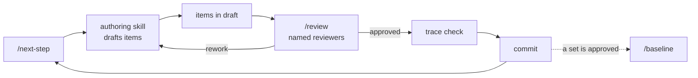

# User guide

This guide is for the people who use the toolkit on a project: engineers, test
engineers, project leads, quality, safety and cybersecurity engineers. It explains how
the work flows from the first session to a delivered release, what you do and what the
toolkit does, and what to do when it refuses something.

The [README](../README.md) says what the toolkit is. The command reference is
[.claude/docs/tools.md](../.claude/docs/tools.md), and the rules every skill follows are in
the [working agreement](../.claude/docs/working-agreement.md). This guide does not repeat
them; it shows how they fit together in daily work.

## Contents

1. [What you are working with](#1-what-you-are-working-with)
2. [Install](#2-install)
3. [Ten minutes with the worked examples](#3-ten-minutes-with-the-worked-examples)
4. [Start a project](#4-start-a-project)
5. [The daily loop](#5-the-daily-loop)
6. [Your path through the processes](#6-your-path-through-the-processes)
7. [Reviews: how an item becomes approved](#7-reviews-how-an-item-becomes-approved)
8. [Tests and other evidence](#8-tests-and-other-evidence)
9. [Baselines, changes and problems](#9-baselines-changes-and-problems)
10. [Managing the project](#10-managing-the-project)
11. [Functional safety](#11-functional-safety)
12. [Cybersecurity](#12-cybersecurity)
13. [Documents and other tools](#13-documents-and-other-tools)
14. [Before an assessment or a delivery](#14-before-an-assessment-or-a-delivery)
15. [Reading the trace check](#15-reading-the-trace-check)
16. [When the toolkit says no](#16-when-the-toolkit-says-no)
17. [Saving time and tokens](#17-saving-time-and-tokens)
18. [Questions](#18-questions)

## 1. What you are working with

You work in a Claude Code session opened on your project's repository. You type a skill
such as `/sw-requirements`, and the skill holds a conversation with you: it asks, shows
options, waits for your decision, drafts, and asks before it writes anything. Behind the
skills are four kinds of parts:

| Part | What it does | What it never does |
|---|---|---|
| **Skills** (`/name`) | lead one activity of a process, in the order question, options, decision, draft, approval | decide for you, approve, invent a reviewer or an agreement |
| **Agents** | roles that draft (system engineer, software architect, test engineers, safety and cybersecurity engineers...) or read independently (`aspice-reviewer`) | approve; the reviewing agent cannot even write |
| **Tools** (`tools/*.py`) | compute facts: coverage, link status, hashes; write evidence records from tool output; generate documents | judge |
| **Hooks** | guard every write: protect accepted inputs, final records and baselined items; check each item as it is written | stay silent when they could not run - they say `NOT ASSESSED` |

### The ideas you need

| Term | Meaning |
|---|---|
| **Item** | one Markdown file with YAML front matter, one requirement, component, test case or record per file. The ID is a prefix and a number (`SWR-0003`); the folder follows from the type ([schema/item-format.md](../schema/item-format.md)) |
| **Status** | engineering items go `draft` -> `in-review` -> `approved` (or `rejected`, `obsolete`). Records are `final` and never edited again |
| **Link** | written on the downstream item only: a software requirement is `derived_from` a system requirement, a component `fulfils` a requirement, a test `verifies` a unit. The reverse direction is computed |
| **Content hash** | a fingerprint of an item's content. Approval, baselines and suspect links refer to it, so changing an item makes its approval stale without anyone touching the status |
| **Review record** | the only thing that makes an item approved: who reviewed, against which checklist, the verdict, the findings, and the hashes of the items reviewed and of the upstream items they were compared with |
| **Scope** | `project.yaml` names the processes your team is responsible for. Only their rules are active |
| **Imported input** | what you received from outside your scope (customer requirements, system architecture...). Registered unchanged, accepted in a review, never edited; questions about it are `query` items |
| **Trace check** | `python tools/traceability.py check`: every finding about structure, links, coverage, stale approvals and suspect links, one line each |
| **Baseline** | a final record of approved items with their hashes, anchored to a Git tag. Items in it change only through an approved change request |

### Who does what

| People of the team | The toolkit |
|---|---|
| decide scope, design choices, ratings, treatment of risks | asks the questions, shows options and their consequences |
| review and approve, by name | prepares the review, applies the checklist, proposes findings |
| agree with the customer and suppliers | records an agreement only when you say it happened, with whom and when |
| run tests on targets and benches | specifies the tests, turns the bench's report into a record |
| rate capability levels (assessors) | shows evidence and gaps per base practice |

Three kinds of statements are kept apart in everything the toolkit tells you:
**deterministic** (from a tool, quoted), **semantic** (a model's reading, always with the
text it rests on, a proposal until a person confirms it) and **accountable** (what a
named person stated). If a skill gives you a coverage figure or a test result, it ran the
tool; if it could not, it says `NOT ASSESSED`.

## 2. Install

You need Claude Code, Git, and Python 3.10 or later with PyYAML
(`python -m pip install pyyaml`). python-docx (Word) and openpyxl (customer Excel
workbooks) are optional; a C compiler is needed only to run the examples' tests.

**As a plugin (recommended for a real project).** Your items stay in your repository,
the toolkit stays in the plugin. In Claude Code, inside your project:

```
/plugin marketplace add Lieubk/automotive-safety-security-assurance-kit
/plugin install assurance-kit@assurance-kit
```

From a shell, `claude plugin marketplace add Lieubk/automotive-safety-security-assurance-kit`
followed by `claude plugin install assurance-kit@assurance-kit --scope project` does the
same and writes the plugin into the project's `.claude/settings.json`, so every member of
the team is asked to install it. Skills are then available as `/aspice-start` or
`/assurance-kit:aspice-start`.

**In a copy of the repository.** Clone it and open it in Claude Code; every skill, agent
and hook is active. Good for trying things out, less good for a real project, because your
items and the toolkit's files share one repository.

**The first session.** With the plugin, a new session prints the toolkit's root folder
and the working agreement. In every setup it then prints - once `project.yaml` exists -
the scope, the number of items and the open errors, or, before that, a pointer to
`/aspice-start`. With the plugin the tools run from your project folder as
`python "<toolkit root>/tools/<script>.py"`. In this guide commands are written as
`python tools/<script>.py`, the form that works in a copy of the repository.

To be asked for permission less often, allow the read-only commands
(`traceability.py check`, `status`, `list`, `show`, `practices`...) in your project's
`.claude/settings.json`, with the path the session printed.

## 3. Ten minutes with the worked examples

Two complete projects show what a finished state looks like. All their content is
invented demonstration data.

| Example | Who | What it shows |
|---|---|---|
| [examples/power-window](../examples/power-window/README.md) | a software supplier | SWE.1 to SWE.6 down to C code, unit, integration and qualification tests that really run; MAN.3, SUP.1, SUP.8, SUP.9; ISO 26262 at ASIL B; a component-level TARA; 31 generated documents |
| [examples/door-control-unit](../examples/door-control-unit/README.md) | a system supplier | SYS.2 to SYS.5 with bench runs, a supplier, risks, vulnerability monitoring, a baseline and a release, a mock assessment |

From the toolkit root:

```
python tools/traceability.py --project examples/power-window check
python tools/traceability.py --project examples/power-window status
python tools/traceability.py --project examples/power-window practices SWE.2
python tools/traceability.py --project examples/power-window show SWR-0003
python tools/traceability.py --project examples/power-window impact SWR-0003
python tools/traceability.py --project examples/power-window matrix
python examples/power-window/tests/unit/run_tests.py
```

Then open a few items to see what they look like: `spec/views/VIEW-0001.md` (structure),
`spec/software/requirements/SWR-0003.md`, `spec/software/design/UNT-0003.md` next to
`src/antipinch/AntiPinch.c`, and one review record under `records/reviews/`. The
generated documents are in
[examples/power-window/documents](../examples/power-window/documents/).

A good exercise before your own project: copy `examples/power-window` to a scratch
folder, change one figure in the statement of `spec/software/requirements/SWR-0003.md`,
and run `python tools/traceability.py --project <the copy> check`. The approval of
SWR-0003 is now stale (`COV-19`), and the component, the unit and the qualification test
that build on it are reported as `SUSPECT` until a review compares them with the new
text. Nobody touched a status - that is how the toolkit keeps approvals honest.

## 4. Start a project

### 4.1 Set the scope: `/aspice-start`

Open Claude Code in your project and run `/aspice-start`. It asks one thing at a time and
reads back what it will record. Have these answers ready:

| Step | Question | Why it matters |
|---|---|---|
| 1 | Your role in the supply chain: vehicle manufacturer, system supplier, software supplier, component supplier, engineering service | proposes a typical set of processes - only a proposal |
| 2 | What you received, per level: document name, version, date, format | decides what must be registered and accepted at the boundary |
| 3 | Automotive SPICE 3.1 or 4.0, and the processes your team is responsible for | only the rules of these processes are active |
| 4 | Whether an assessment is planned, and which processes it rates | a process that is rated but not in your scope is flagged on day one |
| 5 | Target capability level | level 2 or 3 brings MAN.3, SUP.1 and SUP.8 into view |
| 6 | Highest ASIL, cybersecurity relevance, the parts of ISO 26262 and clauses of ISO/SAE 21434 that are yours; design and review conventions; checklists the customer prescribes | safety and security rules, coverage targets, review independence |
| 7 | Platform and toolchain: AUTOSAR or not, microcontroller, compiler, static analyser, test and coverage tools, ALM tool | a tool that is missing later shows as `NOT ASSESSED`, never as a silent skip |
| 8 | Source roots, generated and third-party code | every source file must belong to one software unit (`COV-11`) unless a pattern exempts it |
| 9 | The people who review and approve, and who decides on change requests; who holds the safety and cybersecurity roles | review records need real names and a reviewer who did not write the item |
| 10 | (derived) where you start, which inputs and plans you need, in which order to work | your first work list |

"Not decided yet" is a valid answer; it stays empty and shows up as open. The skill writes
`project.yaml` and nothing else. The file names real people: it belongs in your project
repository, not in anything you publish.

Run `/aspice-start` again whenever role, scope or inputs change. Taking a process out of
scope silences its rules - it hides findings without resolving them, so the skill asks
before doing it.

### 4.2 Register what you received: `/import-inputs`

Each delivered requirement or element becomes one imported item, word for word, with its
source, version and date. Requirements in ReqIF or Excel are read by `tools/reqif.py` and
`tools/xlsx.py`; other formats are read as documents. What is unclear in the delivery
becomes a `query` item addressed to whoever delivered it - you never "fix" an input.

Then run `/review` on the imported items: the **input acceptance review** is what lets
your own work build on them. When a new version arrives, `/import-inputs` compares it with
what you have and the trace engine shows what became suspect.

### 4.3 Write the plans the scope needs

The first `check` of a new project reports `COV-27` once for every plan your scope needs.
That is the expected first work list, not a defect. Each plan is written by the skill of
its process and approved by `/review`:

| Plan kind (as `COV-27` names it) | Written by |
|---|---|
| `project` | `/project-plan`; its work packages come from `/work-breakdown` |
| `risk-management` | `/risk-management` |
| `quality-assurance`, `verification` | `/quality-assurance` |
| `configuration-management` | `/baseline` |
| `change-request-management` | `/change-request` |
| `problem-resolution` | `/problem-resolution` |
| `unit-verification`, `software-integration`, `software-qualification-test` | `/sw-unit-verify`, `/sw-integration-test`, `/sw-qualification-test` |
| `system-integration`, `system-qualification-test` | `/sys-integration-test`, `/sys-qualification-test` |
| `safety`, `development-interface-agreement` | `/safety-plan` |
| `cybersecurity`, `cybersecurity-interface-agreement`, `production-control`, `cybersecurity-incident-response`, `end-of-cybersecurity-support` | `/cybersecurity-plan` |
| `cybersecurity-monitoring` | `/vulnerability-management` |
| `release` | `/release` |
| `operation-and-service` (ISO 26262 part 7) | no skill: written by hand as a `plan` item and reviewed with [the plan checklist](../.claude/docs/checklists/plan.md) |

### 4.4 Ask what comes next: `/next-step`

`/next-step` reads the state of the items, the open findings and the evidence per base
practice, and names one skill to run next with the items it concerns, plus what else is
open. It changes nothing. Use it at the start of every session and whenever you are
unsure.

## 5. The daily loop

Almost all work follows the same loop:



Rules of thumb:

- **Work and approve from the top down.** The tool refuses to approve an item while
  something it builds on is still in draft or in review (`UPSTREAM`), unless both are
  reviewed together.
- **Never change a status by hand.** `approved` comes only from a review record that
  covers the item's current hash; the check reports anything else.
- **Commit after every review.** A re-review finds the text that was reviewed in the Git
  history by its hash; uncommitted, it cannot. The skills propose the commit and run it
  only on your yes.
- **Read `check --all` while drafting.** On drafts it shows `info` lines such as "still
  to come before approval: ...", so you see what a review will ask for before you start
  one.
- **Ask `/trace-check` when a finding is unclear.** It explains what the rule wants and
  which skill addresses it.

## 6. Your path through the processes

The order below is the usual one. Each authoring step ends with `/review`; supporting
work (plans, problems, changes, status) runs alongside.

### Software supplier

| Step | Skill | What you get |
|---|---|---|
| 1 | `/aspice-start` | `project.yaml` |
| 2 | `/import-inputs`, then `/review` | system requirements, elements and interfaces as imported items (SYR, SYE, SYI), queries (QRY), input acceptance |
| 3 | plans, see 4.3 | approved plans (PLN), work packages (WP) |
| 4 | `/sw-requirements` | software requirements with verification criteria and analysis (SWR) |
| 5 | `/sw-architecture` | components, interfaces, views, design decisions (CMP, IFC, VIEW, ADR), every requirement allocated |
| 6 | `/sw-detailed-design` | component designs and software units with function contracts (CDS, UNT) |
| 7 | `/sw-unit-implement` | the code of an approved unit design, exactly as designed |
| 8 | `/sw-unit-verify` | unit test cases and test code (UT), test runs with coverage, static analysis runs (RUN, SAR) |
| 9 | `/sw-integration-test` | integration steps, test cases (SIT), a build record per step (BLD), runs |
| 10 | `/sw-qualification-test` | test cases from the requirements (SQT), runs on the last build, or from a bench report |
| 11 | `/baseline` | baseline record (BL), Git tag, communication record (CMR) |
| 12 | `/documents`, `/release` | the documents the customer expects, the release record (REL) and its delivery |

An AUTOSAR Classic model can start the architecture: `/sw-architecture` imports
components and interfaces from ARXML (`tools/arxml.py`) and later compares the model and
the items.

### System supplier

| Step | Skill | What you get |
|---|---|---|
| 1 | `/aspice-start`, `/import-inputs`, `/review` | the customer's requirements as stakeholder requirements (STK), accepted |
| 2 | `/sys-requirements` | system requirements (SYR) |
| 3 | `/sys-architecture` | system elements and interfaces (SYE, SYI), views, decisions, allocation |
| 4 | the software path above, or the software received as an element | |
| 5 | `/supplier-monitoring` | agreements with suppliers (SAG), supplier reviews (SRV) |
| 6 | `/sys-integration-test` | integration steps, test cases (SYIT), system build records, bench runs |
| 7 | `/sys-qualification-test` | test cases from the system requirements (SYQT), bench and vehicle runs |
| 8 | `/baseline`, `/release` | baseline, release record, delivery and receipt |

### Component supplier or engineering service

Start at the first process your contract names. `/aspice-start` derives which inputs you
need at that boundary - for example the architecture around your component - and
`/import-inputs` registers them. A test-only work package starts at the test skill, with
the requirements or architecture it tests against as imported inputs.

## 7. Reviews: how an item becomes approved

`/review` is the only way an item becomes approved. Without arguments it collects what is
waiting: drafts, stale approvals, suspect and unconfirmed links. It then works one review
at a time:

1. **Group and order.** Items that must be read together, one checklist per review,
   top-down.
2. **Checklist.** `python tools/record.py checklists --type <type>` names the checklist
   to cite. A project may keep checklists of its own under `checklists/` that extend or
   replace the toolkit's - for example the checks a customer prescribes.
3. **In review.** On your yes the items go to `in-review`; their content is frozen from
   now on.
4. **Script checks** come from the trace check and are quoted.
5. **Semantic checks.** Two ways, and you choose: the independent `aspice-reviewer`
   agent, which reads every subject and upstream item in full on a strong model (the
   largest share of a review's cost), or the session itself for up to three items, which
   is cheaper and not independent - the record then says so.
6. **Findings.** You accept, reject, change or add the proposed findings. Only what a
   person confirms becomes a finding.
7. **Accountable checks** are asked as questions to the person who can answer them, for
   example the safety manager. "Not yet" leaves the check `not-assessed` and nothing is
   approved until the answer exists.
8. **Reviewers and verdict.** You name the reviewers - at least one who did not write
   the items - and give the verdict `approved` or `rework`. The skill never proposes one.
9. **Record.** `tools/record.py review` writes the record with the hashes; then the
   status changes.

The tool refuses `approved` while a finding is open, a check has no result, an
accountable check was answered with a finding, or an upstream item is not approved.
That is the point: do not change a finding or a check to get past it.

**After a change.** A re-review reads only what changed since the earlier record
(`traceability.py diff <ID> --since <REV-ID>`). An item that did not change but whose
upstream did is confirmed with `record.py review --reconfirm`, without a checklist.

**Code.** A unit can be approved as a design before it has code. Once code exists, the
review of the code names a commit with a clean working tree, and the record stores a
hash of every source file. Code that changes later makes the unit `SUSPECT` again.

## 8. Tests and other evidence

Evidence records are written by tooling from tool output, never typed in. A test result
nobody ran does not exist.

| Evidence | Produced by | Recorded with |
|---|---|---|
| unit test run with coverage | your test runner, gcov or your coverage tool | `record.py test-run --level unit` (`/sw-unit-verify`) |
| static analysis | your analyser | `record.py analysis-run` |
| build of an integration step | the build's manifest | `record.py build --step <name>` |
| integration and qualification runs | runner on the host, or the JUnit XML report of a test bench | `record.py test-run --level software-integration` (or `software-qualification`, `system-integration`, `system-qualification`) with `--build <BLD-ID>` |
| results kept in an Excel test report | the sheet | `tools/xlsx.py results`, then `record.py test-run` |

Things worth knowing:

- Coverage targets per ASIL are set in the approved unit verification plan; `COV-28`
  checks the latest run against them. A figure below target is accepted only with a
  deviation a person states (`--deviation`).
- A run stores a hash of every source and test file. When code changes after the run,
  `COV-30` says the run no longer describes the code: run and record again.
- Tests on a target or a bench are specified, traced and recorded here and executed
  there. Bring the bench's report back as JUnit XML or Excel.
- A pipeline (`ci/`) reports; it records nothing. A CI run becomes evidence when a person
  decides so and it is recorded from a clean, committed tree.

## 9. Baselines, changes and problems

### Baselines: `/baseline`

Needs an approved configuration management plan. The skill tells you which baseline is
due, checks the preconditions (no error in the check, every item of the scope approved
or left out with a stated reason), writes the record, shows the commit and tag commands
and runs them only on your yes. Pushing is yours. Afterwards it records who was informed
(`COV-26` stays open until then). `traceability.py audit <BL-ID>` compares a baseline with
the items as they are now.

Baselines of a purpose marked internal in `project.yaml` freeze nothing. Every other
baseline protects its items.

### Changes: `/change-request`

An item inside a baseline changes only through an approved change request that names it -
the write hook refuses the edit otherwise. The request goes `submitted` -> `analysed`
(impact analysis: `traceability.py impact <ID>` and a search for what links cannot know)
-> `approved` by the people who decide (recorded in their words) -> `implemented` (each
affected item through its own skill and `/review`) -> `verified` -> `closed` once the
requester is informed.

Outside a baseline no change request is needed: change the item with its authoring skill
and review it again. When an item changes, `impact <ID>` lists what is now suspect.

### Problems: `/problem-resolution`

A failed test, a defect found outside a review, a report from a customer or supplier
becomes a problem report (PRB): `open` -> `analysed` (cause, impact, severity) ->
`in-resolution` -> `resolved` -> `closed` with the retest or review that shows the fix
works. While it is unresolved, `PROBLEM` warns on every approved item it affects. The
strategy defines urgent actions and alerts; trend reports are written from
`traceability.py problems`.

## 10. Managing the project

| Need | Skill | Tool view |
|---|---|---|
| scope, life cycle, milestones, resources, interfaces | `/project-plan` | |
| work packages, estimates, schedule, dependencies | `/work-breakdown` | |
| progress against the plan, status report, corrective actions | `/project-status` | `traceability.py progress` |
| risks rated, treated, monitored, accepted | `/risk-management` | `traceability.py risks` |
| quality assurance checks, non-conformances, escalation | `/quality-assurance` | `traceability.py quality` |
| supplier agreements, reviews, open items | `/supplier-monitoring` | `traceability.py suppliers` |
| release plan, release record, delivery | `/release` | |

Work packages link the items they deliver; `progress` reads their state from those items,
so a package that its owner calls done while its items are still in draft is reported.
The figures come from the tool; the assessment in a status report is in the words of the
person who reports.

## 11. Functional safety

When the highest ASIL is above QM, `scope.safety` names the parts of ISO 26262 that are
yours. The usual order:

| Step | Skill | What you get |
|---|---|---|
| 1 | `/safety-plan` | safety plan with a decision per clause, methods per table, the ASIL and tool confidence determinations as your project applies them, confirmation measures, tool evaluations (TEV) |
| 2 | `/hara` | item definition, hazardous events (HZE) with severity, exposure and controllability, safety goals (SG) - or the customer's goals as imported inputs |
| 3 | `/safety-concept` | functional, technical and software safety requirements (system and software requirements with an `asil`), decomposition as a design decision |
| 4 | `/safety-analysis` | FMEA, FTA or another method, dependent failures analysis (SAN), findings carried into requirements or design |
| 5 | `/component-qualification` | qualification of supplied or reused software components (CQL), or a proven-in-use argument (PIU) |
| 6 | `record.py confirmation-measure`, `record.py safety-case` | confirmation reviews, audits, assessments as the people who did them state; the safety case with the argument of the person who prepares it |

`traceability.py safety` shows per clause the plan's decision, the evidence and the open
findings. An item may not carry a lower ASIL than what it is derived from (`COV-23`)
unless an approved decomposition covers it.

The tables of the standard (ASIL determination, tool confidence, methods per ASIL) are
not reproduced in the toolkit: your safety plan states the ones you apply. Hardware
development (part 5) and motorcycles (part 12) are not supported.

## 12. Cybersecurity

When the product is cybersecurity relevant, `scope.cybersecurity` names the clauses of
ISO/SAE 21434 that are yours.

| Step | Skill | What you get |
|---|---|---|
| 1 | `/cybersecurity-plan` | plan with a decision per subclause, tailoring with reasons, the TARA method (impact categories, feasibility approach, your risk matrix), interface agreement, post-development plans |
| 2 | `/tara` | item definition, assets, damage and threat scenarios with attack paths, ratings, risk values from your matrix, treatment, goals and claims (ITM, AST, DMG, THR, CSG, CLM) |
| 3 | `/cybersecurity-concept` | requirements derived from goals, security relevance carried down to design, code and tests, verification and validation |
| 4 | `/vulnerability-management` | monitoring plan, events (CEV), weaknesses (WKN) analysed and treated |
| 5 | `record.py cybersecurity-case`, `cybersecurity-assessment` | the case with the argument of the person who prepares it; the judgement of an independent assessor |

`traceability.py tara` lists threat scenarios by risk value with the value your matrix
gives; `traceability.py clauses` shows per subclause the decision, evidence and open
findings. Ratings and treatment decisions are proposed by the skill and made by you.

## 13. Documents and other tools

### Documents: `/documents`

Forty kinds - requirement specifications, architecture and design descriptions, test
specifications and reports, traceability, review, release, quality, problem, change,
project, risk and supplier reports, TARA, safety and cybersecurity plans and cases - are
generated from the items as HTML, PDF, Word or Excel:

```
python tools/document.py list
python tools/document.py build software-architecture-description --format docx
python tools/document.py build software-requirements-specification --format pdf --baseline BL-0001
```

- Items stay the single source; never edit a generated document and feed it back.
- Only approved items appear unless you ask for drafts. A document that shows items not
  approved, or comes from uncommitted changes, is marked DRAFT.
- With `--baseline` the document shows exactly the baseline's items and is refused when
  one of them changed since.
- Ask your customer for their Word template or Excel workbook and set it in
  `project.yaml` (`documents.template`, `documents.excel_maps`); otherwise the style is
  neutral.
- Output goes to `build/documents/`.

### Exchange

| With | Tool | Use |
|---|---|---|
| ReqIF (DOORS and others) | `tools/reqif.py` | import a delivery, compare a new version, export your items |
| Excel | `tools/xlsx.py` | import requirements from a sheet, compare, export, read test results |
| Polarion, codebeamer, Jama Connect | `tools/alm.py` | pull work items as imported items, push your items; credentials from environment variables only. Try `--dry-run` on your server first |
| AUTOSAR Classic | `tools/arxml.py` | start the architecture from a model, compare model and items |
| CI | `ci/github-actions.yml`, `ci/gitlab-ci.yml` | fail the pipeline on errors of the check, keep the reports as artifacts |

## 14. Before an assessment or a delivery

| Question | Use |
|---|---|
| What evidence do we hold per base practice, and what is open? | `python tools/traceability.py practices [PROCESS]` |
| What does the repository show for the generic practices of level 2? | `python tools/traceability.py generic [PROCESS]` |
| Is a process ready? | `/process-gate` - a verdict per base practice and per process: `PASS`, `CONCERNS`, `FAIL`, `NOT ASSESSED` |
| How would an assessment go? | `/mock-assessment` - evidence pack, interview questions, ratings N, P, L, F given by named people of the team, checked for consistency |
| Is the baseline still what was delivered? | `python tools/traceability.py audit <BL-ID>` |

The states `practices` reports are observations, not ratings:

| State | Meaning |
|---|---|
| `evidence present` | items exist, all approved or final, no rule objects |
| `warnings open` | as above, with warnings on this practice |
| `evidence not settled` | items exist, not all approved or final |
| `no evidence yet` | the schema has a place for the evidence, and nothing is there |
| `findings open` | errors concern this practice |
| `no evidence structure` | the toolkit cannot tell; a person has to show the evidence |

The toolkit rates nothing. A gate or a mock assessment tells the team where it stands;
an assessment rates.

## 15. Reading the trace check

```
python tools/traceability.py check          # findings that need action
python tools/traceability.py check --all    # also gaps on drafts, and what each draft still needs
```

Each line gives level, rule, item, message and the base practices concerned; the last
line sums up items, scope, active rules, errors and warnings. Levels: `error` on approved
items or broken structure, `warning` on items in review or missing consistency evidence,
`info` on drafts. The command exits with code 1 when there are errors.

The findings you will meet most:

| Finding | What it means | What to do |
|---|---|---|
| `FORMAT`, `SCHEMA`, `LINK` | the file, a required attribute or section, or a link target is wrong | correct the item with its authoring skill |
| `COV-27` | a plan your scope needs is missing or not approved | the skill of 4.3, then `/review` |
| `COV-19` | an approval is missing, or stale because the content changed | `/review` |
| `SUSPECT` | something the item builds on - or a unit's code - changed after the review | `/review`: a re-review, or `--reconfirm` when the item itself did not change |
| `CONSISTENCY` | a review did not record what the item was compared with, or a unit's code was never reviewed | `/review` with the upstream items, or with the code |
| `UPSTREAM` | the item is approved but something it builds on is not | approve the upstream item first |
| `QUERY` | an open question to the source of an input concerns an approved item | get the answer, record it with `/import-inputs` |
| `PROBLEM` | an unresolved problem report affects an approved item | `/problem-resolution` |
| `COV-05`, `COV-06` | a system requirement allocated to software has no software requirement, or a software requirement has no source | `/sw-requirements` |
| `COV-07`, `COV-08` | a requirement is allocated to no component, or a component fulfils no requirement | `/sw-architecture` |
| `COV-25` | an architecture view of a required kind is missing | `/sw-architecture`, or declare the kind not applicable with a reason in `project.yaml` |
| `COV-09`, `COV-11` | a developed component has no design or units; a source file belongs to no unit | `/sw-detailed-design` |
| `COV-12`, `COV-28`, `COV-29`, `COV-30` | unit not tested or analysed, coverage below target, a function untested, the run older than the code | `/sw-unit-verify` |
| `COV-13`, `COV-14` | an interface without an integration test, a requirement without a qualification test | `/sw-integration-test`, `/sw-qualification-test` |
| `COV-23` | an ASIL lower than that of its source | correct the ASIL, or `/safety-concept` for a decomposition |
| `COV-26` | a baseline was not communicated | `/baseline communicate` |
| `CHECKLIST` | a project checklist under `checklists/` is malformed, takes a name of the toolkit's, or extends a toolkit checklist at a version that is no longer current | correct it; `/review` explains the format |

For any other rule, `/trace-check` explains it, and
[schema/items.yaml](../schema/items.yaml) states what each rule expects and when it is
waived.

## 16. When the toolkit says no

Refusals are the toolkit working as intended. Each has a legitimate way forward:

| Refusal | Why | The way forward |
|---|---|---|
| "is an imported input that has been accepted, and is read-only" | inputs are not yours to edit | a `query` to the source; a new delivery through `/import-inputs` with a new version |
| "is a final record and is never edited" | evidence is not rewritten | write a new record that supersedes it |
| "is part of baseline ... Changing or retiring it needs an approved change request" | the baseline protects what was delivered | `/change-request` first |
| `record.py review` refuses `approved` | an open finding, a check without result, an accountable check answered no, an upstream item not approved | close the finding in a new review, get the answer, approve upstream first |
| `record.py baseline` refuses | errors in the check, items not approved | fix the errors; approve the items, or leave them out with a reason you state |
| `record.py release` refuses | changed or internal baseline, errors, missing safety or cybersecurity case | settle what it names |
| `NOT ASSESSED` | a tool did not run (PyYAML missing, no compiler, no Git) | install or provide it; nothing was established until then |
| a skill says its process is out of scope and stops | the rules of that process are not active for you | change the scope with `/aspice-start` if the work really is yours |

Never edit a record, a status or a finding to make a message disappear. The message is
the information.

## 17. Saving time and tokens

- **Let the agents' models do their job.** Judgement (independent review, architecture,
  system engineering) runs on a strong model; drafting and tool-driving on a cheaper one;
  `/trace-check` and `/next-step` on the smallest. Set `CLAUDE_CODE_SUBAGENT_MODEL` only if
  you must run everything on one model (see the README, "Models").
- **Review in sensible batches.** The independent pass is the most expensive part of a
  review; group items that belong together, and choose the in-session pass for one to
  three small items.
- **Re-review the difference, not the whole.** After a change, a re-review reads the diff;
  an unchanged item is reconfirmed without a checklist.
- **Use the tools directly for facts.** `check`, `status`, `show`, `impact` and `practices`
  answer in seconds without a model.

## 18. Questions

**Can I write items by hand instead of through a skill?**
Yes. Items are plain files in the format of [schema/item-format.md](../schema/item-format.md);
`python tools/record.py next-id <type>` gives the next free ID, and the write hook checks
every file you save. The skills add the questions, the analysis and the checklist self-check.

**Who can be a reviewer?**
A named person. A model, an agent or a tool never is. At least one reviewer must not
have written the items; `conventions.review_independence` in `project.yaml` can ask for
more.

**Our customer delivered finished software requirements. Is SWE.1 still ours?**
Possibly, in the eyes of an assessor: a delivery replaces writing the requirements, not
analysing them, giving them verification criteria and agreeing them. `/aspice-start`
shows the difference between your scope and the assessment scope; decide it with the
customer and the assessor.

**Can the toolkit say we reach capability level 2?**
No. It shows evidence and gaps per practice; an assessment rates.

**We use Automotive SPICE 4.0.**
Set it in `/aspice-start`. The 4.0 catalog is built from the draft 3.991, which its
publisher marks as not for assessments; each 4.0 practice reads the evidence of the 3.1
practices it maps to.

**Where do the generated files go, and what do I commit?**
Commit `project.yaml`, items, records, code and tests. `build/` (documents, logs, test
results) is not under version control.

**A session started with an error count. Is something broken?**
On a new project, `COV-27` errors for missing plans are normal. Run `/next-step`.
