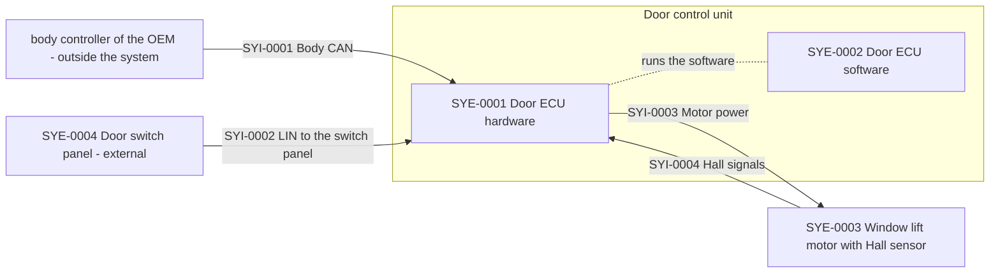

## Description

The four elements of the door control unit and the interfaces between them. An arrow points from the provider to the user of what the interface carries. The software element SYE-0002 runs on the hardware element SYE-0001; its bus and sensor interfaces are drawn to the hardware, which carries them.

Two things to read from the picture: the motor (SYE-0003) is connected to the hardware only, by the power interface SYI-0003 and the Hall signals SYI-0004; the body controller of the OEM is outside the system and reaches it only on the body CAN SYI-0001.

## Diagram

