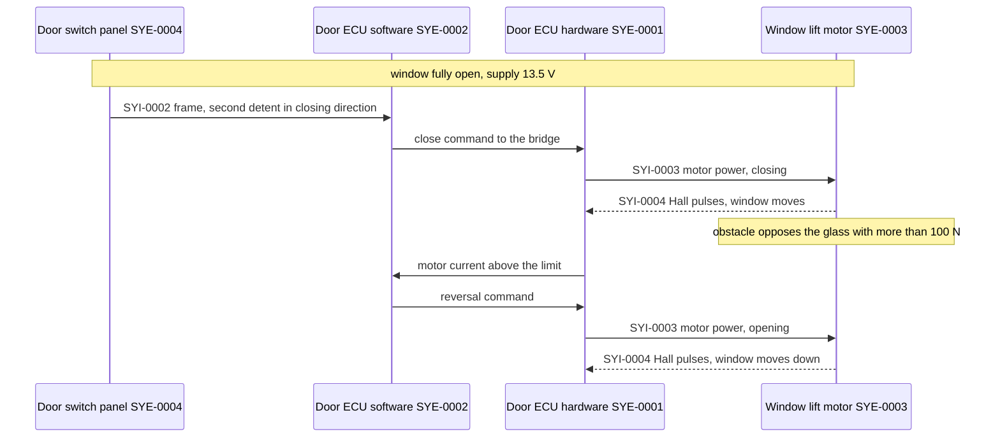

## Description

Scenario: the window is fully open, supply 13.5 V, the occupant presses the switch beyond the second detent in closing direction, and during closing an obstacle opposes the glass with a force of more than 100 N. The sequence ends when the window has reversed.

| Step | Time | Source |
|---|---|---|
| Panel sends the frame with the second detent | within 40 ms after the press | SYE-0004 |
| Software evaluates the frame and starts the closing | within 20 ms (one 20 ms cycle) | SYE-0002 |
| Motor current rises above the limit that corresponds to 100 N | set by the obstacle | SYE-0001 |
| Software detects the current above the limit | within 5 ms (one 5 ms cycle) | SYE-0002 |
| Software commands reversal, bridge changes direction | within 35 ms | SYE-0001, SYE-0002 |
| Motor changes direction | within 100 ms | SYE-0003 |

The times from the detection of the force to the change of direction add up to 5 ms + 35 ms + 100 ms = 140 ms, below the 200 ms observation limit of SYR-0003. If the frame of the switch panel is missing for 100 ms, the unit stops the closing; if the current measurement is invalid, the unit reverses.

## Diagram

