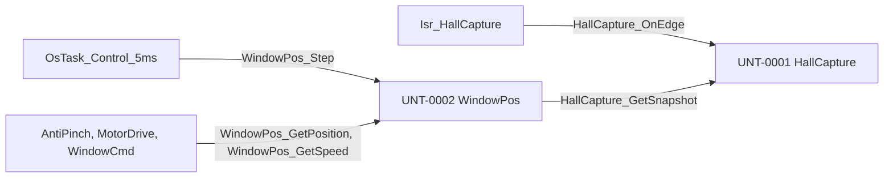
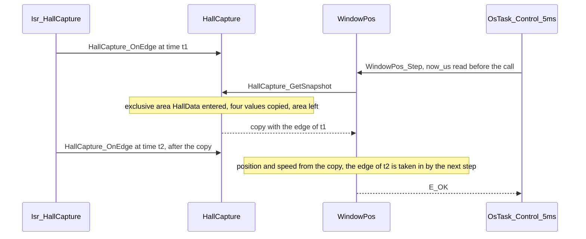

## Design concept

The component is split where its two execution contexts meet. Everything that happens
at interrupt level is in one small unit, HallCapture (UNT-0001): it accepts or rejects
an edge and keeps four numbers. Everything that needs a decision - counting direction,
range limits, standstill, reference - is in unit WindowPos (UNT-0002), which runs in
the 5 ms task and sees the pulse data only as a copy taken at one instant.

Decisions taken here:

- **No hardware access, no generated headers.** The units receive time stamps, the
  current time and the drive direction as arguments. The integration code of the
  customer (CMP-0006) connects them to the timer and to IFC-0005. Both units run on a
  development host unchanged.
- **One copy per cycle.** UNT-0002 calls `HallCapture_GetSnapshot` exactly once per
  step and works on the copy. Position and speed of one cycle come from the same
  pulse data.
- **Unsigned differences.** Pulse counter (16 bit) and time stamps (32 bit) wrap; all
  differences are taken modulo the width of the type, so a wrap needs no special case.
  The pulse counter difference is valid for up to 65535 pulses per step, the time
  difference for up to 2^31 us; larger time differences mean "edge newer than now".
- **Fixed-point only.** Position in counts of 0.5 mm, speed in mm/s, one 32 bit
  division per cycle.
- The measuring principle itself (pulse period, not pulse count) is decided in
  ADR-0001.

## Static structure

| Unit | Files | Visible to other components | Uses |
|---|---|---|---|
| UNT-0001 HallCapture | `src/windowpos/HallCapture.h`, `.c` | `HallCapture_OnEdge` (IFC-0001), `HallCapture_Init` | exclusive area HallData of CMP-0006 |
| UNT-0002 WindowPos | `src/windowpos/WindowPos.h`, `.c` | `WindowPos_Init`, `WindowPos_Step`, `WindowPos_GetPosition`, `WindowPos_GetSpeed` (IFC-0002) | UNT-0001, IFC-0005, IFC-0007 |

`HallCapture_GetSnapshot` and `HallCapture_SnapshotType` are for use inside the
component only. Neither unit exports a variable; all data is file-local.

## Dynamic behavior

Start-up: `HallCapture_Init`, then `WindowPos_Init`, both with the capture interrupt
disabled (VIEW-0004).

One cycle with a pulse arriving while the task runs:

- The interrupt can occur at any point of `WindowPos_Step`. It is locked only between
  entering and leaving the exclusive area (four assignments).
- An edge between the reading of the timer by the integration code and the snapshot
  has a time stamp later than `now_us`; UNT-0002 treats the time since the last pulse
  as 0 in this case.
- The getters are called by other components in the same task or in the 20 ms task.
  Tasks do not preempt each other, so they never observe a half-updated step.

## Design evaluation

Limits of this project for hand-written units: cyclomatic complexity at most 10 per
function, nesting depth at most 4, at most 4 parameters, no recursion, no dynamic
memory. Decided by the software lead for the whole project; `conventions.design_limits`
in `project.yaml` points here.

| Aspect | Result |
|---|---|
| Interaction | One call from interrupt, one from the task, two read functions. The only shared data is the pulse data of UNT-0001, guarded by one exclusive area. No call chain deeper than three functions. |
| Interoperability | Depends on `Std_Types.h` and on two exclusive area services of the basic software; no register, no compiler extension, no assumption on byte order. Types of IFC-0002 are plain `uint16`. |
| Criticality | ASIL B for both units: a wrong position can switch the detection off inside the protected zone, a speed that is too high can hide an obstacle. Both units get the full unit verification of the project: unit tests of every function with boundary values and error cases, static analysis, code review. |
| Technical complexity | Highest cyclomatic complexity 9 (`WindowPos_UpdateSpeed`), all other functions at most 5; nesting depth at most 3; at most 3 parameters. Within the limits. |
| Testability | Every input is an argument or comes from one stubbed function; every output is readable through a getter or the snapshot. UNT-0001 is tested with the two exclusive area services replaced by counting stubs, UNT-0002 with `HallCapture_GetSnapshot` replaced by a stub that returns prepared pulse data. No test needs the target. |
| Risks | See below. |

| Risk | Effect | Measure | Owner |
|---|---|---|---|
| Run-out pulses after a change of direction are counted in the new direction (up to 3 per change) | position error of up to 1.5 mm per change, which shifts the 5 mm zone limit by that amount | error removed at every reference (SWR-0002); stated in SWR-0001, Analysis, for the customer's system analysis | software architect |
| A window blocked while opening looks like the open end stop | opening reported larger than it is; the protected zone ends earlier, never later | accepted, see SWR-0002, Analysis | software architect |
| Execution time of the interrupt and of the exclusive area cannot be shown on a host | budget of VIEW-0004 not confirmed | measurement on the door module by the customer at integration; values entered in VIEW-0005 | software project lead |
| After a pause in which the timer wraps, the first interval can by chance be below 400 us and the edge is rejected | one pulse (0.5 mm) lost, once per pause at a probability of about 1 in 10 million | accepted; removed at the next reference | software architect |
