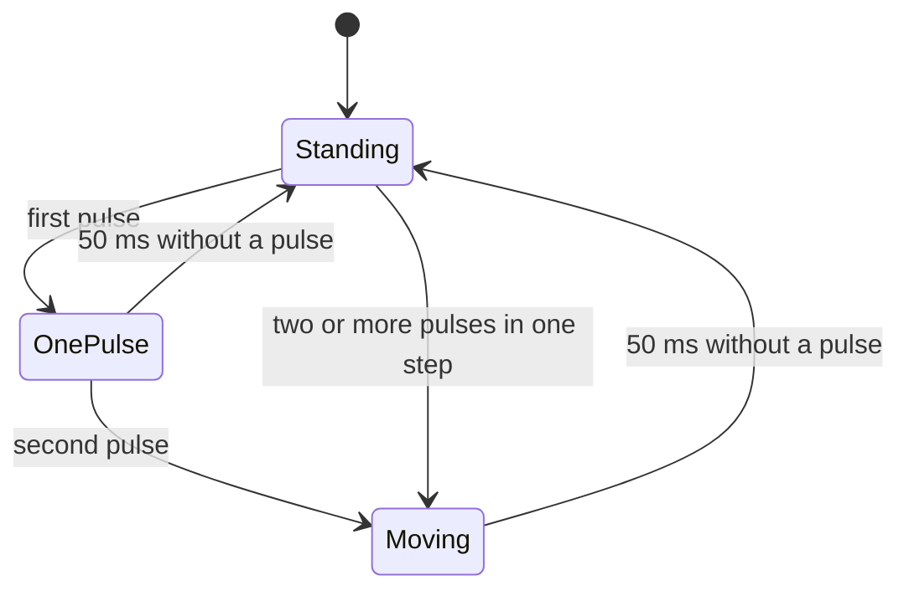

## Purpose

Makes a position and a speed out of the pulse data of UNT-0001: counts the pulses in
the drive direction, keeps the result inside the travel range, finds the fully open end
stop, and converts pulse timing into millimetres per second in a way that shows a
slowing window without waiting for its next pulse.

## Behavior

Scaling: position in counts of 0.5 mm (1 count = 1 Hall pulse), 0 = fully closed,
960 = fully open; speed in mm/s without sign.

Constants:

| Name | Value | Meaning |
|---|---|---|
| `WINDOWPOS_POSITION_MAX` | 960 counts (480 mm) | upper limit of the position |
| `WINDOWPOS_POSITION_INVALID` | 65535 | value delivered while the position is not referenced |
| `WINDOWPOS_SPEED_MAX_MM_S` | 500 mm/s | upper limit of the speed |
| `WINDOWPOS_SPEED_NUMERATOR` | 500000 | 0.5 mm per pulse, expressed for a period in us and a speed in mm/s |
| `WINDOWPOS_STANDSTILL_US` | 50000 us (50 ms) | pulse period or pulse-free time from which the speed is 0 (10 mm/s) |
| `WINDOWPOS_FASTEST_PERIOD_US` | 1000 us | period at and below which the speed is 500 mm/s |
| `WINDOWPOS_TIME_HALF_RANGE_US` | 2^31 - 1 us | larger time differences mean "edge newer than now" |
| `WINDOWPOS_PULSES_FOR_PERIOD` | 2 pulses | pulses needed after a standstill before a period is used |
| `WINDOWPOS_REFERENCE_CYCLES` | 40 cycles (200 ms) | cycles with opening drive at 0 mm/s after which the end stop is assumed |

`WindowPos_Step(now_us, direction)`, after the argument check and one snapshot:

1. **New pulses** = snapshot pulse counter minus the counter of the last successful
   step, as unsigned 16 bit subtraction.
2. **Counting direction**: if `direction` is opening or closing, remember it. If it is
   stopped, keep the remembered one, so that run-out pulses are counted in the
   direction of the movement that caused them.
3. **Position** (only while referenced): closing subtracts the new pulses, not below
   0; opening adds them, not above 960.
4. **Speed**:
   - Time since the last pulse = `now_us` minus the time stamp of the last edge,
     unsigned 32 bit; a result above 2^31 - 1 means the edge is newer than `now_us`
     and is taken as 0.
   - Pulses since standstill: add the new pulses, stop at 2.
   - No pulse since standstill: speed 0.
   - Otherwise, time since the last pulse 50 ms or more: standstill. Speed 0, pulses
     since standstill back to 0.
   - Otherwise, fewer than 2 pulses since standstill: speed 0 (the period of the first
     pulse spans the pause).
   - Otherwise: effective period = the longer of the snapshot period and the time
     since the last pulse. Speed = 0 for 50 ms or more, 500 for 1000 us or less, else
     500000 / effective period, rounded down.
5. **Reference**: count the consecutive steps with `direction` = opening and speed 0;
   any other step sets the count to 0. In the step in which the count reaches 40, and
   in every further such step, the position is set to 960 and marked as referenced.

Speed states of the unit:

The speed is 0 in Standing and OnePulse and comes from the effective period in Moving.

## Error handling

| Error | Detected by | Reaction | Reported |
|---|---|---|---|
| Drive direction above 2 | `WindowPos_Step`, before anything else | step refused, nothing read or changed | return value `E_NOT_OK` |
| Pulse data not readable | `WindowPos_Step`, return value of `HallCapture_GetSnapshot` | step refused, nothing changed, pulses stay pending | return value `E_NOT_OK` |
| Null pointer | both getters | nothing written | return value `E_NOT_OK` |
| Position not referenced | `WindowPos_GetPosition` | writes 65535 | return value `E_NOT_OK` |
| More pulses than travel | step 3 | position limited to 0 or 960 | not reported |
| Effective period of 1000 us or less, including 0 | step 4 | speed 500 mm/s; the division is never done with a divisor below 1001 | not reported |

After a refused step the getters deliver the values of the last successful step. The
caller of `WindowPos_Step` sees the refusal; AntiPinch receives the same invalid
direction and reverses a closing movement (SWR-0006).

## Dynamic behavior

All functions run at task level: `WindowPos_Init` in `OsTask_Init`, `WindowPos_Step`
as first entry of `OsTask_Control_5ms`, the getters in that task and in
`OsTask_Command_20ms`. Tasks do not preempt each other, so the unit's data needs no
protection. The only contact with the interrupt is the call of
`HallCapture_GetSnapshot`, once per step. The step has no loop; its execution time does
not depend on the number of pulses.

## Design notes

- Position and speed are updated even while the drive is stopped, because the glass
  runs on after the bridge is switched off.
- The reference is taken while the step sees speed 0, which at the start of an opening
  movement is the case for the first cycles as well; 200 ms is longer than the 60 ms
  until the first pulse of a starting drive (SYE-0002) by a wide margin.
- `WindowPos_Position` is not changed while the position is not referenced; its value
  then has no meaning and is never delivered.
