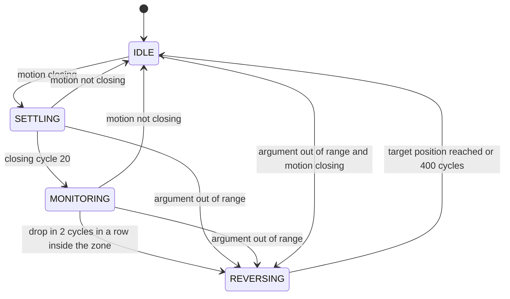

## Purpose

Decides, once per 5 ms cycle, whether the closing window has met an obstacle, and says
for how long the window then has to be driven open. It is the whole of component
AntiPinch.

## Behavior

Scaling: positions in counts of 0.5 mm (0 = fully closed, 960 = fully open, 65535 =
not referenced), speeds in mm/s, times in 5 ms cycles (one call of `AntiPinch_Step`).

Constants:

| Name | Value | Meaning |
|---|---|---|
| `ANTIPINCH_POSITION_MAX` | 960 counts (480 mm) | largest position |
| `ANTIPINCH_POSITION_INVALID` | 65535 | position not referenced; also used inside the unit for "no target position" |
| `ANTIPINCH_SPEED_MAX_MM_S` | 500 mm/s | largest speed |
| `ANTIPINCH_ZONE_LIMIT` | 10 counts (5 mm) | detection is active above this opening |
| `ANTIPINCH_SETTLING_CYCLES` | 20 cycles (100 ms) | closing cycles before the comparison starts |
| `ANTIPINCH_DROP_THRESHOLD_MM_S` | 20 mm/s | a speed more than this below the reference is a drop |
| `ANTIPINCH_CONFIRM_CYCLES` | 2 cycles (10 ms) | consecutive drop cycles that make an obstacle |
| `ANTIPINCH_REFERENCE_MIN_MM_S` | 50 mm/s | lower limit of the reference speed |
| `ANTIPINCH_REVERSAL_TRAVEL` | 240 counts (120 mm) | opening travel of a reversal |
| `ANTIPINCH_REVERSAL_CYCLES` | 400 cycles (2 s) | longest duration of a reversal |

Reference speed: stored with 4 fractional bits (`AntiPinch_ReferenceQ4`, 1 count =
1/16 mm/s). Update per cycle: stored = stored - stored / 16 + speed, with the division
rounding down, then limited to at least 800 (50 mm/s). This is a first-order low-pass
with a time constant of 5 ms / ln(16/15) = 77.5 ms; at constant speed the reference
reaches the speed exactly. The value compared and reported is stored / 16, rounded
down.

What one step does, by state, when all arguments are in range:

- **IDLE**: `motion` closing: go to SETTLING, this is closing cycle 1. Otherwise stay.
- **SETTLING**: `motion` not closing: IDLE. Otherwise count the cycle; in cycle 20 set
  the reference speed to the current speed, at least 50 mm/s, and go to MONITORING.
  The speed is not compared in this step.
- **MONITORING**: `motion` not closing: IDLE. Otherwise:
  - *Drop*: speed + 20 < reference. The reference is not updated. If `position` is
    above 10 counts (which includes 65535), count the drop cycle; with the second in a
    row go to REVERSING. If `position` is 10 or below, set the drop count to 0.
  - *No drop*: set the drop count to 0 and update the reference.
- **REVERSING**: count the cycle. Go to IDLE if `position` is at most 960 and has
  reached the target, or if this is cycle 400. `motion` is not evaluated.

Entering REVERSING fixes the target: detection position + 240, limited to 960; no
target (65535) if the position at detection is not referenced or not trustworthy.
Entering IDLE clears reference, counters and target.

With an argument out of range the step does not evaluate the state as above; see
Error handling.

## Error handling

| Error | Detected by | Reaction | Reported |
|---|---|---|---|
| `position` 961 to 65534, `speed_mm_s` above 500 or `motion` above 2, in SETTLING or MONITORING | `AntiPinch_Step`, range check of all three arguments before anything else | REVERSING without target position, so the reversal lasts 400 cycles | return value `E_NOT_OK`; state and request in the status |
| The same in IDLE with `motion` closing | as above | as above: a closing movement that starts with an untrustworthy input is reversed in its first cycle | as above |
| The same in IDLE with `motion` not closing, including `motion` above 2 | as above | none; no closing movement is known | return value `E_NOT_OK` |
| The same in REVERSING | as above | the cycle is counted, the target is not checked | return value `E_NOT_OK` |
| Null pointer | `AntiPinch_GetStatus` | nothing written | return value `E_NOT_OK` |
| State variable outside 0 to 3 | `AntiPinch_Step`, default branch | with arguments in range treated as IDLE, with an argument out of range reversed like a supervised closing movement; either way the step leaves a valid state | not reported |

`position` = 65535 is not an error. A reversal is never ended by an out-of-range
argument.

## Dynamic behavior

Both `AntiPinch_Step` and `AntiPinch_GetStatus` run at task level and never
concurrently (VIEW-0004); the unit shares no data with an interrupt. The states and
transitions are given above. Timing follows from the call period of 5 ms: detection
starts 100 ms after the drive has started to close, an obstacle is confirmed in the
second cycle of a drop, a reversal without reachable target ends after 2 s. The step
has no loop.

## Design notes

- The drop condition is written as speed + 20 < reference, so that no subtraction can
  go below zero.
- The invalid position value lies above the zone limit on purpose: one comparison
  covers "inside the protected zone" and "position unknown".
- The request is derived from the state when the status is read; it is not stored, so
  state and request cannot disagree.
