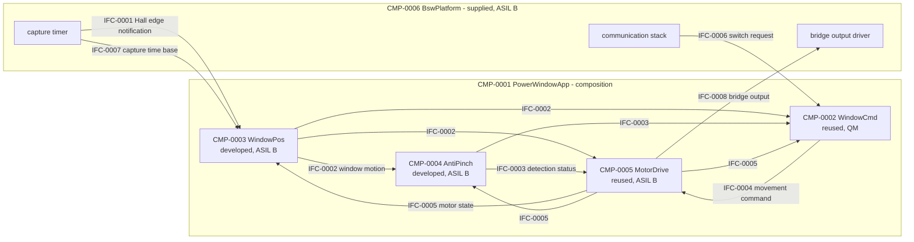

## Description

The delivered composition PowerWindowApp with its four components, the basic software
of the customer next to it, and every interface between them. An arrow points from the
provider of data to its user; for the two function-call interfaces towards the basic
software it points from caller to callee.

Two things to read from the picture:

- The path from the Hall sensor to the bridge - WindowPos, AntiPinch, MotorDrive - is
  ASIL B throughout and takes no input from WindowCmd.
- WindowCmd (QM) only consumes data and issues the movement command; MotorDrive lets
  the reversal request of AntiPinch override that command.

## Diagram

