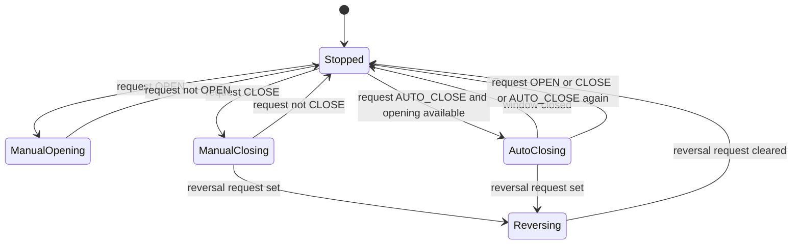

## Description

What the window does, seen across the components. The states Stopped, ManualOpening,
ManualClosing and AutoClosing are states of WindowCmd, which issues the matching
movement command (IFC-0004). Reversing is not a state of WindowCmd: it is entered when
AntiPinch sets the reversal request (IFC-0003) and exists in MotorDrive, which drives
the window open as long as the request is set. WindowCmd notices it and goes to
Stopped, so that the window does not close again by itself afterwards.

| State | Movement command | Bridge (IFC-0005) |
|---|---|---|
| Stopped | stopped | stopped |
| ManualOpening | opening | opening, stopped at the open end stop |
| ManualClosing | closing | closing, stopped at the closed end stop |
| AutoClosing | closing | closing, stopped at the closed end stop |
| Reversing | stopped (ignored) | opening |

"Request" in the diagram is the switch request of IFC-0006; a lost or reserved value
counts as NONE. After start-up the state is Stopped.

## Diagram

