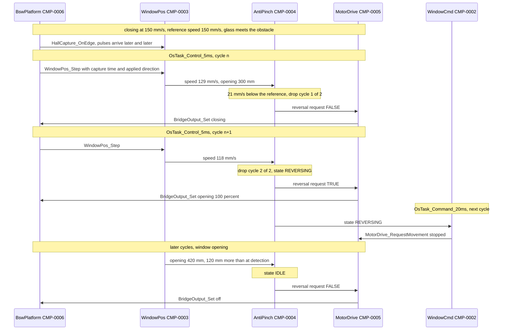

## Description

The window closes automatically at 150 mm/s; at an opening of 300 mm the glass meets
an obstacle. The sequence shows which component does what in which task cycle, and
where the time budget of 20 ms (SYE-0001) is spent.

| Step | Latest time after the speed has fallen more than 20 mm/s below the reference | Requirement |
|---|---|---|
| First cycle that sees the fall | 5 ms | SWR-0003 |
| Reversal request set (second cycle in a row) | 10 ms | SWR-0004 |
| Bridge commanded "opening", same cycle | 10 ms plus the run time of the task, at most 15 ms | SWR-0007 |

The reversal ends when the opening has grown by 120 mm (SWR-0005). WindowCmd runs in
the 20 ms task, sees state REVERSING within 20 ms and withdraws its movement command;
the obstacle reaction does not wait for it.

## Diagram

